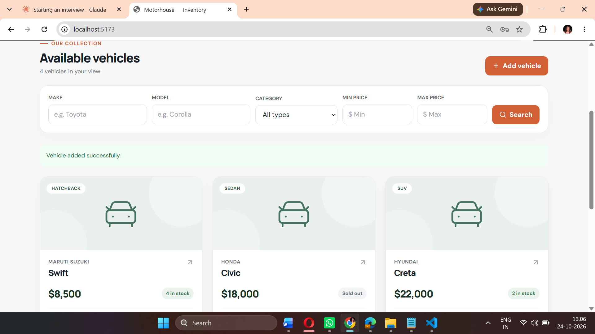
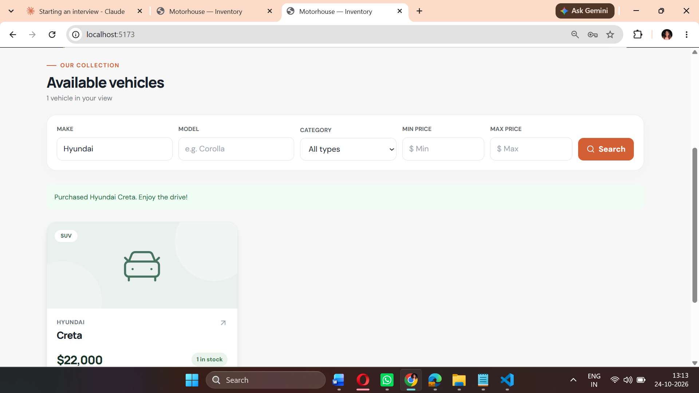

# Motorhouse — Car Dealership Inventory

A full-stack inventory application with a React single-page interface, FastAPI REST API, SQLite persistence, JWT login, and admin inventory controls. Buyers can search and purchase vehicles; administrators can add, edit, delete, and restock them. Stock updates use conditional SQL updates so simultaneous purchases cannot make inventory negative.

## What you need

- Python 3.10 or newer
- Node.js 18 or newer and npm
- VS Code (optional)

## Run locally in VS Code (Windows PowerShell)

1. Unzip this project and open the `car-dealership` folder in VS Code.
2. Open a terminal for the backend:

```powershell
cd backend
py -m venv .venv
.\.venv\Scripts\Activate.ps1
python -m pip install -r requirements.txt
$env:JWT_SECRET = "replace-this-with-a-random-secret-at-least-32-characters"
python -m app.create_admin
python -m uvicorn app.main:app --reload
```

When `create_admin` asks, enter an admin email and password. The terminal hides password input. Keep the backend terminal running. The database file `backend/inventory.sqlite3` is created automatically and persists after restart. Never commit your real JWT secret or the database.

3. Open a **second** terminal for the frontend:

```powershell
cd frontend
npm install
npm run dev
```

4. Open http://localhost:5173. Sign in using your admin account, add a few vehicles, and try searching, purchasing, editing, and restocking. Use **Create account** to register a regular buyer and see that admin actions are hidden. FastAPI API documentation is available at http://localhost:8000/docs.

If PowerShell blocks script activation, run `.venv\Scripts\python.exe -m uvicorn app.main:app --reload` instead, and use that Python executable for installation and admin setup. On macOS/Linux use `python3 -m venv .venv`, `source .venv/bin/activate`, and `export JWT_SECRET='a-long-random-secret'`.

### Running later

Start the backend from `backend` with the same `JWT_SECRET` and `python -m uvicorn app.main:app --reload`. Start the frontend from `frontend` with `npm run dev`. You only need `npm install`, `pip install`, and `create_admin` the first time. The database stays on disk.

### Configuration

| Variable | Default | Purpose |
| --- | --- | --- |
| `JWT_SECRET` | Required | Signs JWTs; use a private random string of at least 32 characters. |
| `DATABASE_PATH` | `backend/inventory.sqlite3` | Persistent SQLite path. |
| `CORS_ORIGINS` | `http://localhost:5173,http://127.0.0.1:5173` | Comma-separated permitted browser origins. |
| `VITE_API_URL` | Empty | Optional absolute backend URL when not using Vite's `/api` proxy. |

## API

| Method | Route | Access | Purpose |
| --- | --- | --- | --- |
| POST | `/api/auth/register` | Public | Register a buyer. |
| POST | `/api/auth/login` | Public | Get a bearer token and role. |
| GET | `/api/vehicles` | Signed in | List all vehicles. |
| GET | `/api/vehicles/search` | Signed in | Case-insensitive make/model/category and `min_price`/`max_price` filters. |
| POST | `/api/vehicles` | Admin | Add a vehicle. |
| PUT | `/api/vehicles/{id}` | Admin | Update supplied fields. |
| DELETE | `/api/vehicles/{id}` | Admin | Delete a vehicle. |
| POST | `/api/vehicles/{id}/purchase` | Signed in | Decrement stock by one; out of stock returns 409. |
| POST | `/api/vehicles/{id}/restock` | Admin | Add stock with body `{"quantity": 3}`. |

Vehicle bodies have `make`, `model`, `category`, `price` (nonnegative), and `quantity` (nonnegative integer). Login tokens expire after eight hours. Registration never grants admin rights; `python -m app.create_admin` provisions the admin account locally.

## Tests and development history

From `backend` run `python -m pytest -q`. From `frontend` run `npm run build`. See [TEST_REPORT.md](TEST_REPORT.md) for the recorded results. The Git history begins with failing API behavior tests (`red`), then implementation (`green`), followed by the interface. Check it with `git log --oneline --reverse` after unzipping. To understand the stock rule, inspect the conditional `UPDATE ... WHERE quantity > 0` in `backend/app/main.py` and its tests.

## Screenshots

The project does not contain a fabricated screenshot. To capture your **own final running application** for submission, log in as admin, add example vehicles, and save a full desktop screenshot as `screenshots/admin-dashboard.png`; then log in as a buyer and save `screenshots/buyer-dashboard.png`. Add those images to this section before publishing:

```markdown


```

## My AI Usage

- **Tool:** ChatGPT (Codex).
- **How it was used:** Generated the initial backend test cases, FastAPI/SQLite implementation, React/Tailwind UI, project setup instructions, and debugging changes. The tests were run and the frontend production build was checked in the development environment.
- **Reflection:** AI sped up scaffolding and helped cover permissions, validation, and inventory edge cases. The owner should review every route and run the app personally, take genuine screenshots, and be ready to explain why stock changes are atomic and why administrator creation is separate from public registration. Do not claim code or screenshots were made without AI assistance.

The available prompts are recorded in [PROMPTS.md](PROMPTS.md). Add an unedited export of the complete chat or a public chat link before submitting if your evaluator requires the entire conversation. This archive is a working local project, not a published GitHub repository or deployed application; publish it using your own account when ready.
